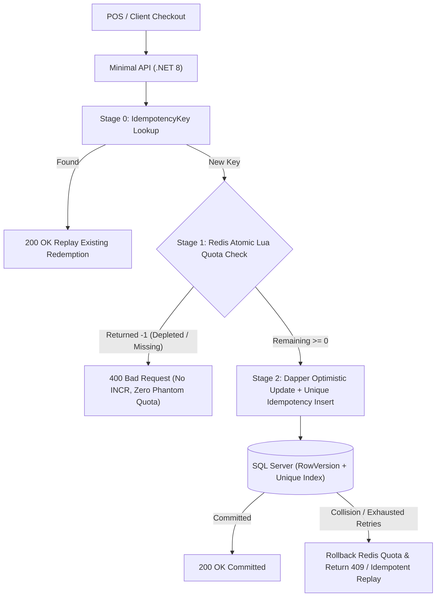

# High-Concurrency Retail Voucher Engine (.NET 8 + Redis + Dapper)
<!-- Clean Architecture Reference Implementation by Truong Van Tinh -->

[](https://dotnet.microsoft.com/)
[](https://github.com/tvt987/high-concurrency-voucher-engine/actions)
[](https://github.com/tvt987/high-concurrency-voucher-engine/tree/master/tests/VoucherEngine.UnitTests)

A Clean Architecture **.NET 8** reference implementation demonstrating multi-stage concurrency guards against voucher double-spending across parallel checkout traffic: **idempotency keys**, **Redis atomic Lua quota checks**, and **SQL Server `RowVersion` optimistic concurrency** via **Dapper**.

---

## Architecture Flow



---

## Key Engineering Choices

1. **Idempotency + Atomic Redis Lua Guard (`CacheServices.cs` & `RedeemVoucherUseCase.cs`)**:
   - The Redis Lua script evaluates `GET` and calls `DECR` **only when `val > 0`**, returning `-1` without mutating Redis when depleted.
   - Because `-1` never decrements Redis, depleted rejections return immediately without calling `INCR`, preventing phantom quota leaks under burst retries.
2. **Strict Committed SQL Server Reads (`DapperVoucherRepository.cs`)**:
   - Intentionally avoids `WITH (NOLOCK)` when reading `RowVersion` and `IdempotencyKey` so optimistic concurrency compares committed database state rather than uncommitted/torn reads.
   - Wraps the decrement + `RedemptionRecords` insert in `SET XACT_ABORT ON` with `TRY/CATCH` rollback and clean handling of SQL unique-constraint violations (`2627`/`2601`).
3. **Environment-Driven Wiring (`Program.cs`)**:
   - Automatically wires `DapperVoucherRepository` + `ConnectionMultiplexer` (`RedisDistributedCacheService`) when `ConnectionStrings:SqlServer` and `ConnectionStrings:Redis` are configured (such as via `docker-compose.yml`), and falls back to thread-safe in-memory implementations (`InMemoryVoucherRepository`, `InMemoryDistributedCacheService`) for local standalone runs and unit tests.

---

## Repository Contents

- `src/VoucherEngine.Domain`: `Voucher`, `RedemptionRecord`, `VoucherStatus`, domain invariants.
- `src/VoucherEngine.Application`: `RedeemVoucherUseCase` with bounded CAS contention retry and idempotency race re-checks.
- `src/VoucherEngine.Infrastructure`: `DapperVoucherRepository`, `InMemoryVoucherRepository`, `RedisDistributedCacheService`, `InMemoryDistributedCacheService`.
- `src/VoucherEngine.Api`: Minimal API endpoints (`/health`, `/api/v1/vouchers/{code}`, `/api/v1/vouchers/redeem`) and multi-stage `Dockerfile`.
- `sql/init.sql`: SQL Server DDL (`Vouchers` with `ROWVERSION` + unique index on `Code`, `RedemptionRecords` with unique index on `IdempotencyKey`, seed voucher `CONCUNG50K`).
- `tests/VoucherEngine.UnitTests`: xUnit domain, idempotency, phantom-quota regression, tight-loop monotonic `RowVersion`, and multi-threaded `Task.Run` concurrency tests.
- `benchmarks/k6_stress_test_5000rps.js`: k6 load-test script template for local Docker/benchmark runs.
- `.github/workflows/ci.yml`: Automated restore, Release build, and test execution via GitHub Actions.

---

## Quickstart & Verification

```bash
# 1. Clone and run the automated unit + concurrency test suite
git clone https://github.com/tvt987/high-concurrency-voucher-engine.git
cd high-concurrency-voucher-engine
dotnet test --configuration Release

# 2. Run API standalone (uses InMemory fallback with seeded CONCUNG50K voucher)
dotnet run --project src/VoucherEngine.Api

# 3. Full stack with SQL Server 2022 + Redis 7 via Docker Compose
docker-compose up --build -d
# Apply schema sql/init.sql to localhost,1433 before hitting /api/v1/vouchers/redeem
```

---

### Author
**Truong Van Tinh** — Full-Stack .NET & Applied AI Engineer  
Email: `tinhkun102@gmail.com` · Portfolio: [tvt987.github.io](https://tvt987.github.io) · GitHub: [github.com/tvt987](https://github.com/tvt987)
